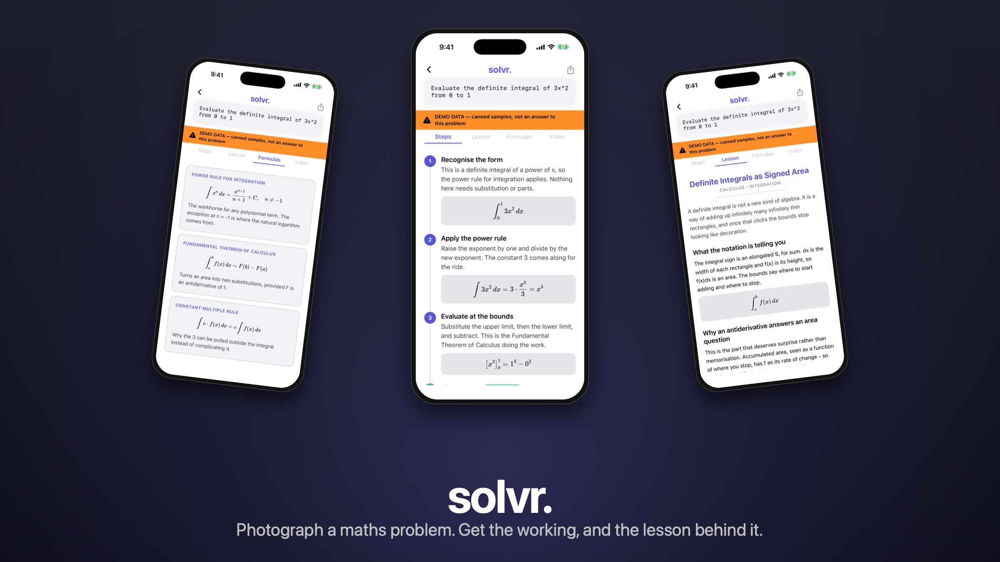
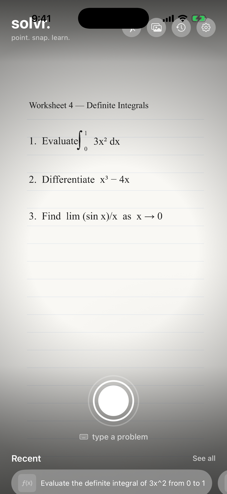
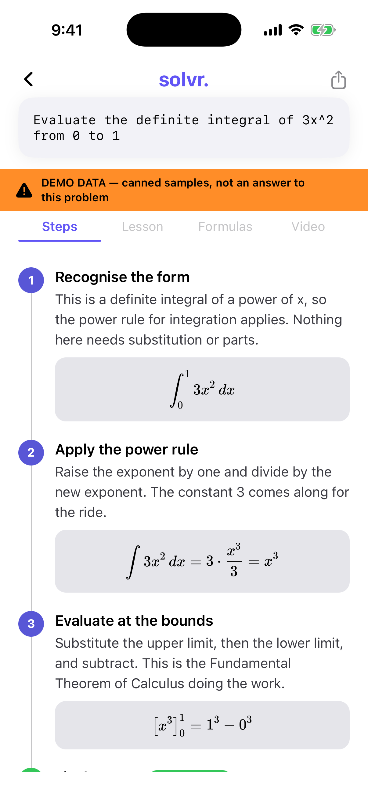
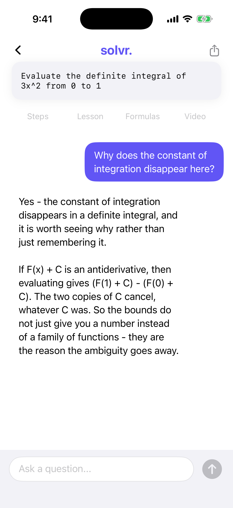
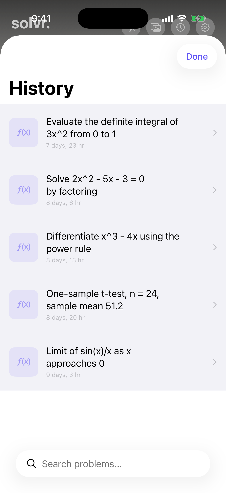
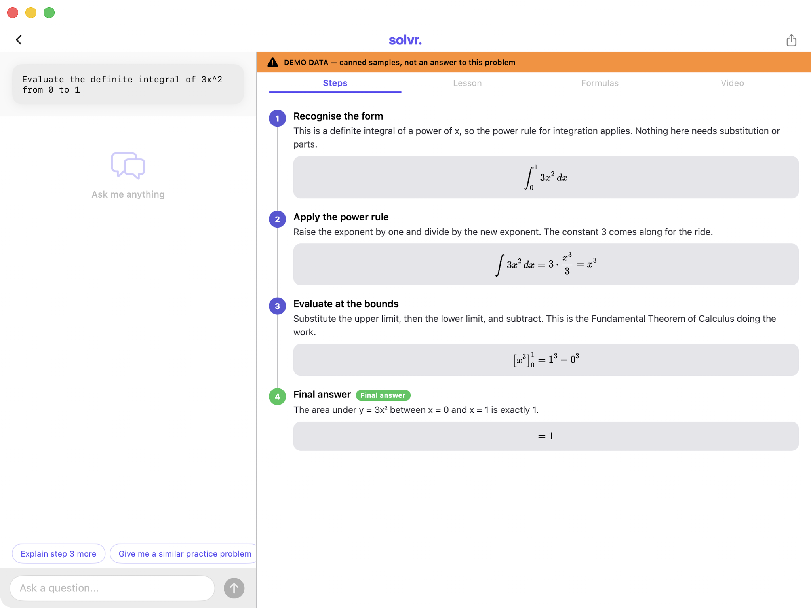

# solvr.ai

[](https://github.com/foggylulu/solvr-ai/actions/workflows/ci.yml)

Photograph a maths problem. Get the working, and the lesson behind it.

A native **iOS and Mac Catalyst** app in Swift and SwiftUI. Point the camera at a
problem — or type it — and it returns step-by-step working with the reason for
each step, the concept the question was testing, the formulas involved, and a
chat to keep asking. It runs entirely on **Apple's on-device foundation model**:
no API key, no server, no network, nothing leaving the device.



> **Status: built and working, not released.** It is not on the App Store, there
> are no users, and there are no download numbers to quote. It runs on my phone
> and on my Mac, and you can run it on yours in about five minutes. There is no
> key to paste and no account to make — see
> [Try it without a key](#try-it-without-a-key) if your device cannot run Apple
> Intelligence.

It exists because I have taught calculus and statistics since 2022 and kept
rebuilding the same lesson plans by hand. The feature set is not a guess about
what students want; it is the four things I found myself writing out over and
over — the working, the concept, the formulas, and answers to "but why".

## What it does

```
photo ──────────► a backend that can see reads it directly;
                  one that cannot gets it via on-device text recognition
                                          │
typed problem ────────────────────────────┤
                                          ▼
                              four requests, in parallel
                                          │
        ┌──────────────┬──────────────┬───┴──────────┬──────────────┐
        ▼              ▼              ▼              ▼              ▼
      Steps         Lesson        Formulas        Videos          Chat
   worked, with   the concept   with the ones   related, by     follow-up
   the reason     behind it     that apply      search terms    questions
```

Maths is rendered as real typeset notation through KaTeX in a web view, not as
plain-text approximations of fractions and integrals.

## The screens

| | | |
|:--:|:--:|:--:|
|  |  |  |
| **Scan** — a crop overlay and live problem detection | **Steps** — each one says which rule applies and why | **Lesson** — the concept, written as a tutor would explain it |
|  |  |  |
| **Formulas** — the ones that actually apply here | **Chat** — follow-ups, with the problem as context | **History** — every problem, stored locally with SwiftData |

Every screenshot in this README is generated by `./tools/screenshots.sh`, in demo
mode, from a clean simulator. Nothing is mocked up in a design tool and nothing
is hand-edited.

## It runs on macOS too



Not a stretched phone app: on the Mac the chat sits alongside the solution
instead of behind a tab, because there is room for it. Built and run as a Mac
Catalyst app — `./tools/screenshot-mac.sh` builds it, runs it and captures it.

**The Mac build is a development build, not a shipped one.** The release
configuration is iPhone-only: no iPad idiom and no Catalyst. The iPad layout is
unexercised, and shipping an idiom nobody has tested is a review finding waiting
to happen. Debug keeps both, which is what the Mac screenshots above are.

## Try it without a key

The whole results surface works with **no API key and no network**:

```sh
git clone https://github.com/foggylulu/solvr-ai.git
cd solvr-ai
open solvr.ai.xcodeproj      # run on any iOS 26 simulator
```

Then turn on **Settings → Try it without a model → Demo mode**, or launch with
`-SolvrDemo YES`. Answers come from bundled fixtures; every problem in them is
synthetic, written for this repository, and while demo mode is on a banner above
every set of results says so.

**Debug builds only.** Demo mode returns the same fixture for every input, so an
app that can be put into that state — from a toggle that persists across
launches, with nothing on screen saying so — is an app whose answers cannot be
told apart from a model that ignores the question. In a release build there is
no demo branch compiled in, and `strings` on the binary finds no fixture text at
all. `tools/check.sh` fails if that guard is ever removed.

Demo mode is not a shortcut around the real code path. The fixtures are stored as
raw JSON containing unescaped LaTeX — exactly what a model sends — and they are
parsed by the same ladder the network path uses. If that ladder regresses, demo
mode breaks visibly.

## No key is required, because there is nothing to key

**The app runs on Apple's on-device model and nothing else.** There is no API-key
wall, no account, no endpoint to configure, and no setting that changes where an
answer comes from — because there is only one place it can come from.

It did not start this way. Earlier versions could be backed by a hosted API or by
a model you served yourself, behind one `SolutionProvider` interface. Both are
gone. What that cost, and what it bought, is written up in
[docs/backends.md](docs/backends.md); the short version is that the measurement
work those backends existed for is finished and published, and keeping a
credential store alive for a comparison that had already been run was the wrong
trade for an app whose point is that it does not need one.

If the on-device model cannot run — the device is not eligible, or Apple
Intelligence is switched off — Settings says so in a sentence.

## Requirements

Requirements: **Xcode 26**, **iOS 26.0** or later, and an iPhone 15 Pro or newer
for on-device answers. No package dependencies to resolve — the only package is
local, in `Packages/`.

## How it is put together

```
solvr.ai/
  Models/          Codable response types, plus the SwiftData Problem
  Services/        ProviderFactory, OCRService, CameraManager, LegacyCredentialPurge
  ViewModels/      one per screen; none of them know how a request was made
  Views/           Home · Scanner · Results (Steps/Lesson/Formulas/Videos/Chat) · History · Settings
  Utilities/       Theme, HTMLBuilder (KaTeX), PlatformHelper
  DemoMode/        fixtures, the drawn worksheet, launch-argument wiring
Packages/SolvrCore/  the text handling that is worth testing, and its 103 tests
```

`SolvrCore` is a local Swift package holding everything that is pure text
processing: the model-output decode ladder, the LaTeX escape repair, HTML
escaping, and the request queue. It imports only Foundation, so
`swift test --package-path Packages/SolvrCore` runs the whole suite in about two
seconds with no Xcode, no simulator and no API key. Anything that cannot be
tested that way stays in the app.

## The part worth reading

Getting structured data out of a language model is the actual engineering here,
and the traps are not where you would expect. The full write-up is in
[docs/ENGINEERING-NOTES.md](docs/ENGINEERING-NOTES.md); the headline is this:

**`"\frac{d}{dx}"` is valid JSON.** `\f` is a form feed, so a strict parse
succeeds and hands back `"<FF>rac{d}{dx}"` — mangled maths, no error raised
anywhere. Any pipeline that tries strict parsing first and repairs only on
failure will silently corrupt every fraction it is given. Repair therefore runs
*before* the first decode attempt, and a test asserts the corruption to keep that
ordering honest.

The repair itself has one rule: **it may never damage input that was already
valid.** The previous version doubled every backslash it found, which fixed
`\frac` and simultaneously turned a legitimate `\"` into a literal backslash
followed by an unescaped quote.

## Tests

```sh
swift test --package-path Packages/SolvrCore    # 103 tests, ~2s, no simulator
xcodebuild -scheme solvr.ai -destination 'platform=iOS Simulator,name=iPhone 17 Pro' build
xcodebuild -scheme solvr.ai -destination 'platform=macOS,variant=Mac Catalyst' build  # debug only
```

[CI](.github/workflows/ci.yml) runs the first of those on every push, asserts
that the test count quoted above matches what the run reports, and checks that
[docs/evaluation-local.md](docs/evaluation-local.md) still regenerates from
[its records](docs/eval-records/). The two `xcodebuild` lines are **not** in CI:
they need Xcode 26 and the iOS 26 SDK, and a workflow pinned to an image that
may not have them yet would produce a red badge that says nothing about the
code. Those two are a local check.

## What the on-device model actually does

Until this release the shipped backend had never been measured. Everything in
[docs/evaluation-local.md](docs/evaluation-local.md) is a local Qwen3-4B, which
is not the model on your phone.

Six problems -- the ones the topic chips insert -- three runs each **on a Mac**,
graded by [the same harness](docs/evaluation-samples.md) that measured the
fine-tune:

| | requests that returned | answer correct | LaTeX that renders |
|---|---|---|---|
| before | 45/54 | 12/18 | 76% (84/111) |
| after | **54/54** | **18/18** | **100% (111/111)** |

Three surfaces per problem — steps, lesson, formulas — so 54 requests. Median
4.1 s each, one at a time.

**And then on the phone, which disagreed.** The app can measure itself on
hardware (`-SolvrSelfTest YES`, transcript in
[docs/eval-records/samples/](docs/eval-records/samples/iphone-15-pro-selftest.txt)),
and an iPhone 15 Pro got `2sin(θ) - 1 = 0` *wrong* — dividing the angle instead
of the equation, π/12 for π/6 — where the Mac had it right, from the same model
under the same greedy decoding. Asking for the same solutions without the
rearrangement is right on both, so that is what the chip asks. All six are now
correct on the phone, at 6–15 s per surface rather than the Mac's 4.

Which is the finding worth keeping: a Mac is not a phone, and a number measured
on the wrong one is a number about the wrong thing.

The nine failures on the left are not the model getting the maths wrong. Three
were a refusal — `x³ · sin(x)` trips a guardrail, `x^3 * sin(x)` does not — and
six were the model generating past its own 4,096-token window: on a six-number
data set, and on a lesson it was allowed three sections to write. The render
failures were mostly two bugs of ours: `√[...]` losing its argument to LaTeX's
optional-index syntax, and a literal `\n` read as an undefined control sequence.

What is **not** claimed: that this generalises. Six problems chosen to be the
app's shop window are the easiest six problems in it, and greedy decoding makes
three runs agree with each other by construction. The number to take seriously
is the one on the left: a third of the examples the app shipped with did not
work at all, and nothing measured them.

## What it does not do

- **Answering on a real device is confirmed; a full offline run is not yet
  written down here.** The on-device model solves on an iPhone 15 Pro — that is
  no longer the open question it was, and the README used to say the model
  reported `modelNotReady` on hardware. Rendering has been offline-clean since
  KaTeX was vendored, and as of this version so is every other path: there is no
  `URLSession` left in either target, and `tools/check.sh` fails the build if one
  reappears. What is not yet recorded is a measured Airplane Mode run, so that
  claim is not made.
- **The hosted comparison was never run, and now cannot be.** A
  constrained-vs-unconstrained hosted method existed in code and no Anthropic
  call was ever made by it; that backend has since been removed. It was method,
  never result. Only the local backends were ever measured against each other,
  and those records are published in full.
- **The fine-tune is not shipped, because it lost.** See below.
- **No answer verification.** The app does not check the model's arithmetic. It
  is a tutor's explanation, not a proof assistant, and a wrong step will be
  presented as confidently as a right one. The Steps tab says so on screen.
- **No accounts, no sync, no telemetry, and now no uploads at all.** History is
  local to the device via SwiftData, and with the hosted backend gone there is
  nothing left that sends the problem anywhere. The only outbound link in the app
  is the YouTube URL you get by tapping a suggested video, which hands off to
  another app rather than fetching anything itself.
- **A photograph is harder than typed text, and there is no longer a backend
  that makes it easier.** Apple's on-device model has no image input at all, so
  every photo goes through Apple's Vision text recognition first, which reads
  printed problems well, handwriting unevenly, and a fraction as two numbers with
  a line between them. The hosted backend used to read the image natively; losing
  that is the clearest thing this version gives up. That downgrade is
  recorded per backend rather than glossed over, which is why a wrapped provider
  reports itself as `<backend>+ocr`.

## What the fine-tune actually did

A LoRA on Qwen3-4B, trained on synthetic problems distilled from a larger model,
then measured against its own base over 43 problems and 387 records
([docs/evaluation-local.md](docs/evaluation-local.md)):

| | base | +LoRA @525 | +LoRA @600 |
|---|---|---|---|
| schema clean — steps | 86% | 88% | **93%** |
| schema clean — lesson | 88% | **98%** | 95% |
| schema clean — formulas | **60%** | 50% | 56% |
| **maths correct** | **74%** | 58% | 55% |
| thin answers (≤1 step) | **8/42** | 18/43 | 17/42 |
| LaTeX renders | 97% | 97% | 97% |

**It learned exactly what it was trained to learn, and that was not what I
wanted.** Compliance improved on the two prose-heavy surfaces, and escape repairs
fell. Correctness fell nineteen points, and the step-count distribution says why:
the tuned model emits **one compliant step instead of working the problem**. Thin
answers more than doubled, and undecidable answers went 4 → 10, because a
one-step answer often has no parseable result in it.

Format overfitting, and 0.091% of the weights was enough to do it. The
uncomfortable part is the metric: **schema compliance cannot see this failure at
all** — a one-step solution that decodes cleanly scores a perfect 100%. The
completeness column is the only reason it was caught, which is an argument for
measuring the thing you want rather than the thing that is easy to count.

One more result worth keeping: validation loss said @525 was far better than @600
(0.338 vs 0.497) and the task metrics called them a tie. A validation loss on two
batches predicted nothing that mattered.

**Recommendation, taken: do not ship it.** Base Qwen3-4B is better overall. What
stays in the repo is the negative result and everything needed to reproduce it —
the training config, the problem generator, the adapter's
`adapter_config.json`, the checkpoint provenance, and the graded records behind
every number above ([docs/eval-records/](docs/eval-records/)). The 14 MB of
adapter weights are **not** tracked: they are a build product, and
`tools/finetune/train.sh` rebuilds them from the config.

## Documentation

- [docs/backends.md](docs/backends.md) — the provider interface, why it lives in
  the package, and where the JSON repair ladder actually earns its keep
- [docs/evaluation.md](docs/evaluation.md) — how the backends are measured, what
  has and has not actually been run, and what is deliberately not measured
- [docs/eval-records/](docs/eval-records/) — the 387 graded records behind every
  number above, with the one command that regenerates the tables from them
- [tools/finetune/README.md](tools/finetune/README.md) — the LoRA run on a 4B:
  synthetic problem generation, distillation, and the checkpoint-numbering trap
  that made "iteration 525" mean something other than it looks like
- **"Teaching a small model to speak your schema"** —
  [PDF](docs/lesson/solvr-cs-lesson.pdf) ·
  [HTML](docs/lesson/lesson.html) · the same material written as a lesson rather
  than as notes: what schema compliance is, why constrained decoding makes it
  free, and what the fine-tune actually taught the model. Typeset by the same
  vendored KaTeX the app ships, so the PDF shows what the app would draw
  (`docs/lesson/build.sh`).

## See also

Parts of the same local-AI setup:

- [**mac-ai-activity**](https://github.com/foggylulu/mac-ai-activity) — what a
  local generation costs: joules per token, per-slot llama.cpp telemetry, die
  temperatures.
- [**llmctl**](https://github.com/foggylulu/llmctl) — which local models are
  holding RAM, and one command to get it back.
- [**wake-on-llm**](https://github.com/foggylulu/wake-on-llm) — turning a big
  local model on from a phone, anywhere, over Tailscale.

## License

GPL-3.0 — see [LICENSE](LICENSE), plus one additional permission under section 7
allowing distribution through Apple's App Store and TestFlight, in
[LICENSE-APPSTORE-EXCEPTION.md](LICENSE-APPSTORE-EXCEPTION.md). Without it a
GPLv3 app is submitted under terms its own licence forbids, which is what got
VLC removed from the store; the exception adds a permission and takes nothing
away. Contributions sign off with the
[DCO](CONTRIBUTING.md#sign-your-work-dco).
